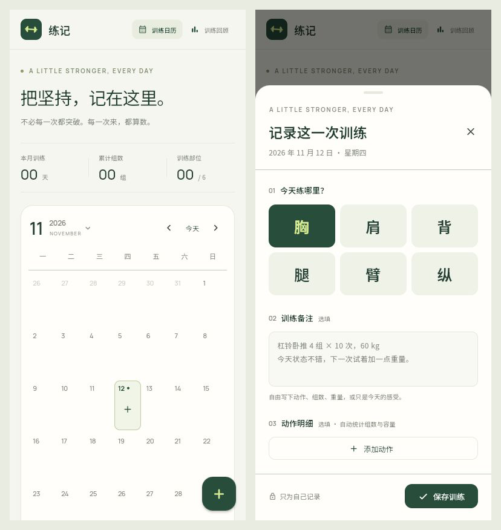

# PullPush

把坚持，记在这里。一个暖白与松绿色的私人训练手账，使用 Flutter / Dart，
同一份代码支持 Android、iOS 和 Web 预览。无需账号，记录保存在本机。



## 已实现

- 周一开始的月历，跨月浏览、回到今天、日期跳转和记录类型筛选。
- 每天一条记录，六个训练标题：胸、肩、背、腿、臂、腹，以及放纵日「纵」，日历以大字展示。
- 点击空日期新增；点击有记录的日期弹窗查看备注、编辑或删除。
- 备注自由填写训练感受；结构化动作使用「部位 → 动作」两级选择器，包含指定的 35 个动作。
- 动作保留稳定编号，独立于每日训练标题，方便后续按动作统计重量与进步趋势。
- 动作明细支持组数、次数，以及「标准重量 / 递减重量」（kg，支持两位小数及自重 0 kg）。
- 递减重量至少填写两级，并逐级降低；可继续添加或删除级别，但不能少于两级。
- 放纵日只填写备注，在日历和月度记录中保留，并单独显示天数，不属于训练部位。
- 自动统计显示月份的训练天数、总组数、训练部位和总容量，以及本周训练节奏。
- 训练回顾展示真实的部位分布和月度记录，不预置示例数据。
- 手机底部编辑弹层、桌面双栏布局、键盘避让、删除确认和未保存修改提醒。
- 读取失败时阻止写入；保存失败时保留草稿，不用空数据覆盖历史记录。

备注是自由文本，不会自动解析；组数与容量仅汇总「动作明细」。
标准重量容量 = 组数 × 每组次数 × 重量。
递减重量容量 = 组数 × 每级次数 × 各级重量之和；每组按同一顺序完成各级重量。
次数可选；标准重量也可留空。缺少次数或重量的动作不计容量。
例如 3 组、每级 10 次、60 → 40 → 20 kg，容量为 3 × 10 × (60 + 40 + 20) = 3600 kg。
「纵」表示放纵日，不计入训练天数、组数、部位、容量或本周训练节奏。
兼容旧版使用 `mixed` 标识的「纵」记录，原有备注和动作明细保留；历史动作不参与统计。
旧版自由输入的动作精确匹配动作库时自动关联编号；未匹配的保留为「历史动作」，可手动重新选择，
不会自动猜测或改名。当前已准备统一动作和重量结构，尚未增加进步趋势图表页面。

## 运行

开发环境：Flutter 3.27.1 / Dart 3.6.0 或兼容版本。
Android 使用 JDK 17–23（推荐 21）、Android SDK 35、NDK 27.1.12297006；
iOS 使用 macOS、Xcode 和 CocoaPods。

```sh
flutter pub get
flutter devices
flutter run -d <设备ID>
```

浏览器快速预览：

```sh
flutter run -d chrome
```

构建 Android 测试安装包、iOS 模拟器及静态 Web：

```sh
flutter build apk --debug
flutter build ios --simulator --no-codesign
flutter build web --release --no-web-resources-cdn
python3 -m http.server 5173 --directory build/web
```

Web 构建在 `build/web`，Android 测试包在 `build/app/outputs/flutter-apk/app-debug.apk`。
Web 预览访问 http://localhost:5173。

本机已生成的 ARM64 测试包为：
`build/app/outputs/flutter-apk/app-arm64-v8a-debug.apk`（约 63 MB，Android 5.0+，仅 ARM64）。
这是开发调试包，不是商店发布包。当前机器的 Wrapper 下载遇到网络错误，因此验证时使用
本机已缓存的 Gradle 8.13 与 JDK 21 直接执行 `assembleDebug`，未修改全局 JDK 配置。

Android 正式发布前需配置自己的应用 ID、release keystore 和签名（模板中的 release
配置仍是测试签名），然后构建 AAB。iOS 真机分发或上架需在 Xcode 配置自己的
Bundle Identifier、Apple Developer Team 和签名证书，再构建 IPA。

## 检查

```sh
flutter analyze
flutter test
dart format --output=none --set-exit-if-changed lib test
```

36 项测试全部通过。覆盖月历边界和闰年、模型校验、持久化往返、损坏数据保护、
完整增删改查、保存失败重试、未保存提醒、动作输入校验、键盘避让、跨年导航、
训练回顾、放纵日编辑与统计排除、35 个动作目录与稳定编号、递减重量校验及容量、精确小数回显、
旧版记录兼容，以及 320 / 390 / 768 像素级联选择与递减表单（含键盘避让）。静态分析、Web release 构建、
Android ARM64 debug 构建均已通过，且已检查浏览器中的手机及桌面实际布局。

iOS 已完成 CocoaPods 依赖安装，但本机 Xcode 缺少所需的 iOS 26.5 模拟器运行时，
因此尚未完成 iOS 原生构建及运行验证。需在 Xcode 的 Settings > Components 中补齐运行时，
再执行 iOS 构建。Android 已在 M2006J10C（Android 12）上安装并完成启动检查，
完整真机验收尚未完成；iOS 尚未进行真机验证。
若本机配置的 HTTP 代理不可用，请先修复代理或仅对这条命令取消代理环境变量；
错误代理也可能阻断 Flutter 测试进程的 localhost WebSocket。

## 数据与隐私

- 使用 `shared_preferences` 存储带版本号的 JSON；兼容 v1，保存为 v2，成功后才更新界面。
- 升级不会清空原记录；v2 避免旧版应用忽略递减级别后静默覆盖数据。不建议降级安装旧版本。
- 不连接业务服务器、无登录、无云端同步。Android、iOS 和浏览器的记录彼此独立。
- Web 数据按浏览器和站点地址隔离；`localhost` 与 `127.0.0.1` 也属于不同的存储。
- 卸载应用、清除应用数据或浏览器网站数据会丢失记录；当前版本不包含备份和导出。
- 训练记录不是加密保险箱，不建议在备注填写敏感身份或医疗信息。

## 代码结构

```text
lib/
  main.dart                        应用入口与中文本地化
  theme.dart                       颜色、字体、组件主题
  models/workout.dart              日期、训练部位、动作和记录模型
  models/training_catalog.dart     六个训练部位、35 个规范动作和稳定编号
  data/workout_repository.dart     本地持久化与格式校验
  screens/home_screen.dart        页面状态与记录流程
  widgets/                        日历、弹层、侧栏和训练回顾
test/                             模型、存储和交互测试
assets/fonts/                     随应用打包的开源字体与许可证
scripts/                          图标和字体生成工具
```

图标为代码绘制，可使用 `python scripts/generate_icons.py` 重新生成（需要 Pillow）。
字体使用 Manrope / Noto Sans SC，随包提供 OFL 许可证，不依赖运行时字体下载。
